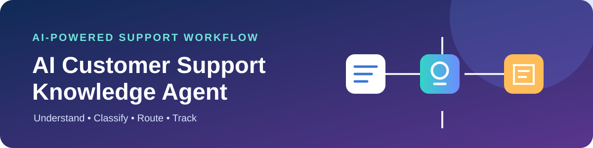
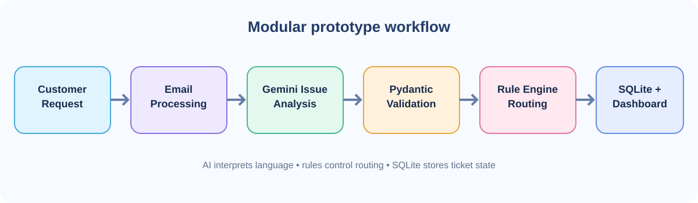
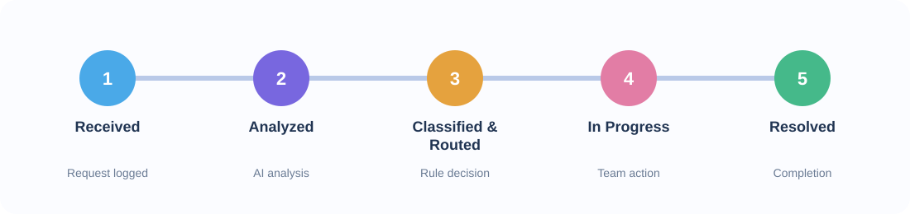

 <div align="center">



# AI Customer Support Knowledge Agent

**An AI-assisted customer support workflow prototype**

[](https://www.python.org/)
[](https://streamlit.io/)
[](https://ai.google.dev/)
[](https://www.sqlite.org/)
[](https://docs.python.org/3/library/unittest.html)

[Overview](#-overview) • [Features](#-features) • [Architecture](#-architecture) • [Setup](#-installation--setup) • [Testing](#-testing) • [Limitations](#-current-status--limitations)

</div>

---

## 🧭 Overview

Customer support teams handle billing complaints, technical issues, account questions, and unclear customer messages. Manually understanding each request, extracting details, assigning a category, and tracking progress can be repetitive and inconsistent.

**AI Customer Support Knowledge Agent** explores a hybrid approach by combining Gemini-powered issue analysis, structured data validation, deterministic business rules, persistent ticket tracking, and a Streamlit dashboard.

The goal is to demonstrate how AI-based language understanding can work alongside predictable business logic in one modular prototype.

## 🎯 Problem Statement

Traditional support workflows can involve:

- Manually classifying incoming customer requests.
- Identifying the customer's underlying intent.
- Extracting useful details from unstructured messages.
- Assigning requests to the right support queue.
- Maintaining visibility into ticket progress.

This prototype addresses these workflow challenges through AI-assisted analysis, rule-based routing, and persistent ticket tracking.

## ✨ Features

| Feature | Description |
|---|---|
| 🧠 AI issue analysis | Uses Gemini to interpret customer messages and identify the underlying support issue. |
| 🏷️ Intent and entity understanding | Extracts structured information from customer requests for downstream processing. |
| ✅ Structured validation | Uses Pydantic to validate structured analysis data. |
| ⚙️ Deterministic routing | Uses Python business rules to assign support categories, queues, and priorities. |
| 🎫 Ticket lifecycle tracking | Persists ticket information and tracks progress using SQLite. |
| 📊 Interactive dashboard | Uses Streamlit to present the support workflow and ticket information. |
| 🧪 Sample scenarios and tests | Includes demonstration inputs and automated tests for key components. |

## 🏗️ Architecture

The prototype separates language understanding from deterministic workflow decisions.

<div align="center">

</div>

### Workflow

1. **Customer request:** A sample email, message, or conversation is provided.
2. **Email processing:** The input is prepared for analysis.
3. **Issue analysis:** Gemini interprets the request and extracts relevant information.
4. **Validation:** Pydantic validates the structured output.
5. **Decision-making:** The Python rule engine evaluates the analysis.
6. **Routing:** The request receives a support category, destination queue, and priority.
7. **Persistence:** Ticket information and state are stored in SQLite.
8. **Monitoring:** The Streamlit dashboard displays workflow and ticket information.

## 🎫 Ticket Lifecycle

<div align="center">

</div>

The later stages may involve human or support-team action; AI analysis does not automatically mean a customer issue has been resolved.

## 🛠️ Technology Stack

| Area | Technology | Role |
|---|---|---|
| Language | Python | Application logic |
| Interface | Streamlit | Interactive dashboard |
| AI | Gemini API | Customer issue analysis |
| AI SDK | Google GenAI SDK | Gemini communication |
| Validation | Pydantic | Structured data validation |
| Decision logic | Python rule engine | Categorization and routing |
| Persistence | SQLite | Ticket storage and lifecycle tracking |
| Testing | `unittest` | Automated tests |
| Version control | Git / GitHub | Source control |

## 📁 Project Structure

```text
AI-Customer-Support-Agent/
│
├── assets/
│   ├── bot_icon.png
│   ├── hero.svg
│   ├── architecture.svg
│   └── ticket-workflow.svg
│
├── tests/
│   ├── test_pipeline.py
│   ├── test_stepper_render.py
│   └── test_ticket_tracker.py
│
├── app.py
├── main.py
├── conversation_manager.py
├── email_processor.py
├── gmail_service.py
├── issue_analyzer.py
├── workflow_router.py
├── ticket_tracker.py
│
├── sample_email.txt
├── sample_thread.txt
├── sample_scenarios.py
├── requirements.txt
├── walkthrough.md
├── .gitignore
└── README.md
```

### Core modules

| File | Responsibility |
|---|---|
| `app.py` | Streamlit application and dashboard |
| `main.py` | Main application workflow |
| `conversation_manager.py` | Conversation-related processing |
| `email_processor.py` | Email input processing |
| `gmail_service.py` | Gmail integration foundation |
| `issue_analyzer.py` | AI-based issue analysis |
| `workflow_router.py` | Support categorization and routing |
| `ticket_tracker.py` | Ticket persistence and lifecycle tracking |
| `sample_scenarios.py` | Demonstration scenarios |

## 🚀 Installation & Setup

### Prerequisites

- Python 3.x
- Git
- A Google Gemini API key
- Terminal / Command Prompt

### 1. Clone the repository

```bash
git clone https://github.com/utk-ver-supm-2005/AI-Customer-Support-Agent.git
```

### 2. Open the project directory

```bash
cd AI-Customer-Support-Agent
```

### 3. Install dependencies

```bash
python -m pip install -r requirements.txt
```

### 4. Configure the Gemini API key

Create a file named `.env` in the project root (the same directory as `app.py`).

```env
GEMINI_API_KEY=your_gemini_api_key
```

Replace the placeholder with your own API key.

> 🔐 **Security:** Never commit `.env` or expose API keys in screenshots, source code, logs, or public repositories. Keep secrets out of version control.

### 5. Run the application

```bash
python -m streamlit run app.py
```

Open the local URL printed in the terminal. Streamlit commonly uses:

`http://localhost:8501`

## 🧪 Testing

Run the test suite from the repository root:

```bash
python -m unittest discover tests
```

The tests cover key application components, including pipeline processing, ticket tracking, and dashboard-related behavior.

## 🧪 Example Scenarios

| Example request type | Example routing outcome |
|---|---|
| API / technical issue | API / Technical support |
| Billing complaint | Billing / Payments |
| Vague or incomplete request | Unclear / Human Review |

Exact outcomes depend on the scenario input and the routing rules configured in the project.

## 💡 Design Decision: Why Combine an LLM with Rules?

An LLM is useful for interpreting natural language, where customers may describe the same problem in many different ways. Business decisions such as assigning a support queue, however, should be predictable and testable.

This project separates the responsibilities:

- **Gemini:** Understands customer language and extracts relevant information.
- **Pydantic:** Validates structured information.
- **Rule engine:** Applies explicit business conditions for categorization and routing.
- **SQLite:** Maintains ticket records and lifecycle state.

This hybrid design makes the workflow easier to inspect, test, and maintain than relying on an LLM to make every decision.

## 📌 Current Status & Limitations

This repository is a **working academic prototype**, not a fully deployed enterprise support platform.

The current project focuses on:

- AI-assisted customer issue analysis.
- Structured information processing.
- Deterministic support categorization and routing.
- SQLite-based ticket lifecycle tracking.
- A Streamlit dashboard.
- Sample scenarios and automated tests.

The broader architecture considers external services such as Gmail, Notion, Jira, GitHub, and Resend. Their inclusion in the architecture does **not** mean every integration is fully connected or production-ready. Refer to the actual implementation before treating any external workflow as operational.

Other limitations:

- The application depends on a valid Gemini API key and external API availability.
- AI-generated analysis can be incorrect and may require human review.
- Routing quality depends on the defined business rules.
- The prototype has not been validated through a large-scale production deployment.
- Enterprise permissions, security controls, and operational monitoring need further development.
- Quantitative performance claims require a documented labelled evaluation dataset and reproducible calculations.

## 🔭 Future Scope

1. **Knowledge-grounded responses:** Implement a complete Retrieval-Augmented Generation (RAG) pipeline over an organization-specific knowledge base.
2. **Enterprise integrations:** Extend and verify connections with services such as Gmail, Notion, Jira, GitHub, and Resend.
3. **Human-in-the-loop controls:** Add review and approval for uncertain or sensitive decisions.
4. **Stronger evaluation:** Build labelled datasets and report reproducible metrics for issue identification, intent classification, entity extraction, routing, and latency.
5. **Observability:** Add structured logs, error monitoring, and workflow-level performance analysis.
6. **Scalability:** Explore deployment patterns for larger support workloads.

## 🎓 Project Context

Developed as an academic project at **Galgotias College of Engineering & Technology**.

The project explores how AI-based customer issue understanding can be coordinated with deterministic business logic and ticket lifecycle management to create a more structured and traceable support workflow.

## 📄 License

No open-source license has been specified yet. Until a license is added, the repository's contents should be treated as all rights reserved.

---

<div align="center">

**Built with Python, Gemini, Streamlit, and a focus on practical AI workflows.**

</div>
